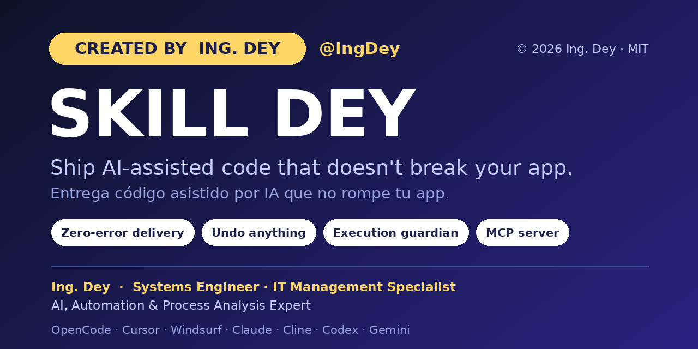
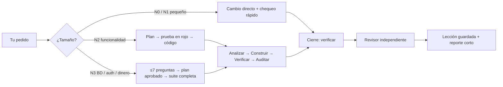

<div align="center">



# 🚀 SKILL DEY

### Entrega código asistido por IA que no rompe tu app.

Un marco de calidad agéntico para el desarrollo asistido por IA: entiende lo que pides, construye **sin romper** lo que ya funciona y no entrega nada con **errores**. Pruebas, seguridad, documentación y ahorro de tokens vienen incluidos.

[](LICENSE.md)
[](#-instalación-rápida)
[](https://opencode.ai)
[](#claude-code)
[](#gemini-cli-y-antigravity-cli)
[](https://modelcontextprotocol.io/)
[](#-funciona-con-tu-ia)
[](https://github.com/IngDey)
[](https://github.com/IngDey/SKILL-DEY-Enterprise-Agentic-Framework-AI-Development-Suite/stargazers)

[English](README.md) · **Español**

**Creado y desarrollado por [Ing. Dey (@IngDey)](https://github.com/IngDey)**<br>
<sub>Ingeniero de Sistemas · Especialista en Gerencia Informática · Experto en IA, Automatizaciones y Análisis de Procesos</sub>

⭐ **Dale una estrella al repo** si te ayuda a entregar mejor código · [⚡ Instálalo en 1 minuto](#-instalación-rápida)

</div>

---

## ¿Por qué SKILL DEY?

Las IA escriben código rápido, pero también rompen lo que funcionaba, filtran secretos, se saltan pruebas y dicen "listo" cuando no lo está. SKILL DEY pone un **ciclo de calidad y un guardián** alrededor de tu IA para que "funciona" signifique *verificado*, no *afirmado*.

| | Qué obtienes |
|---|---|
| ✅ **Entrega sin errores** | Una tarea solo se cierra tras verificar: revisión de todo el proyecto, auditoría de seguridad, probador automático, formato, rendimiento (N+1) y validación en el servidor. |
| 🛟 **Deshacer todo** | Foto automática antes de cada pedido. Escribe *"deshaz"* y tus archivos vuelven, incluso en cambios pequeños. Nunca toca tus ramas ni tu historial. |
| 🛡️ **Guardián de ejecución** | Bloquea secretos en el código, leer `.env`, `git push --force`, commits sin verificar, `.env` subido a git, migraciones de BD sin respaldo, código truncado (`// ...resto del código`) y escrituras fuera del proyecto. |
| 🎯 **Solo cambia lo que pides** | Si la IA quiere tocar un archivo que no pediste, se frena y te pregunta. Nada de reescribir archivos enteros ni "mejoras" que nadie pidió. |
| 🧩 **Piensa antes de tocar** | Antes del primer cambio escribe qué entendió, la causa y el plan. Cada edición se mide: te avisa qué otros archivos usan lo que cambió. |
| 🚑 **Nunca deja la app rota** | Si la app estaba sana y el cambio la rompe y no se arregla en 3 intentos, vuelve sola al estado sano (y puedes "rehaz"). |
| 🧠 **Memoria técnica persistente** | Decisiones, lecciones y reglas de negocio viven en `.skill_dey/` y el contexto sobrevive entre sesiones: *"¿dónde quedamos?"*, *"vuelve a antes de arreglar el login"*. |
| 🤖 **Multi-agente** | Un agente principal, un **explorador** de solo lectura para búsquedas grandes, un agente de **visión** que convierte maquetas/capturas en UI y un **revisor independiente** que audita lo que no escribió. |
| 📉 **Cuida los tokens** | Las tareas pequeñas no cargan la skill; deshacer, historial y "dónde quedamos" se resuelven por código. En OpenCode: modelo según la tarea, cambio automático cuando se acaba el cupo gratis y tablero de consumo. |
| 🌍 **Pruebas en Chrome** | Recorre tu app en tu propio Chrome y lee consola, errores JS, red y respuestas HTTP, con capturas. |
| 🔌 **Servidor MCP incluido** | Expone las revisiones y el deshacer como herramientas nativas para cualquier cliente MCP (protocolo hasta 2025-11-25). |
| 🌐 **Nativo en 4 IAs** | **OpenCode, Claude Code, Gemini CLI y Antigravity CLI** con el mismo guardián en vivo, la misma skill y las mismas reglas. |
| 🏢 **Uso seguro de IA en la empresa** | Skill `politicas-ia`: redacta y revisa la política de uso de IA para las personas (qué usar, qué no, qué datos nunca compartir). |

### 🆕 Novedades de la versión 41

Parte de la v38.14.1 (todo lo de antes sigue igual en OpenCode) y suma:

- **Nativo en Claude Code, Gemini CLI y Antigravity CLI**, con el **mismo guardián** que OpenCode: solo lo pedido, razonar antes de tocar, impacto de cada edición, deshacer, nunca dejar la app rota y continuidad entre sesiones.
- **Una sola fuente de reglas** (`app/skill_dey-lib/guardia.ts`) para las cuatro IAs; un arreglo llega a todas a la vez.
- **Más protección:** bloquea ejecutar scripts descargados sin revisarlos (`curl … | sh`) y reconoce claves de IA y nube de hoy (Anthropic, OpenAI, Google, GitHub, Slack, AWS temporales).
- **Arreglado:** responder *"sí"* con tilde no se tomaba como autorización.
- **Servidor MCP moderno:** protocolo hasta 2025-11-25, verificar, deshacer (con rehacer e historial), congelar, y menos tokens por mensaje.
- **Nueva skill `politicas-ia`:** política de uso seguro de IA para las personas de tu empresa.
- **36 pruebas automáticas** en Windows, macOS y Linux en cada cambio.

---

## 🎯 ¿Para quién es?

- **Desarrolladores** que usan IA a diario y están cansados de arreglar lo que la IA rompió.
- **Líderes técnicos y gerentes de TI** que necesitan que el código generado con IA cumpla un estándar: pruebas, seguridad, documentación y trazabilidad.
- **Empresas** que quieren adoptar la IA en el desarrollo con control, no a prueba y error.
- **Principiantes** que construyen con IA y necesitan una red de seguridad que atrape lo que todavía no saben.

## ⚖️ Tu IA sola vs. tu IA con SKILL DEY

| Tu IA sola | Con SKILL DEY |
|---|---|
| Dice "listo" sin ejecutar nada | Cierra la tarea solo cuando las revisiones están en verde |
| Arregla una cosa y rompe otra | Revisa todo el proyecto y el impacto de cada cambio |
| Puede pegar claves en el código o leer tu `.env` | El guardián lo bloquea antes de que pase |
| Un cambio malo te obliga a rehacer a mano | Escribes *"deshaz"* y tus archivos vuelven |
| Olvida todo entre sesiones | Decisiones, reglas y lecciones quedan en `.skill_dey/` |
| La documentación "después" (nunca) | Manual técnico, diccionario de datos, manual de usuario y PDF cuando los pidas |

---

## 🧭 Cómo funciona



- **La verificación es código, no opinión.** "Funciona" significa verificador en verde, no que el modelo lo diga.
- **Los fallos repetidos escalan.** Tres verificaciones en rojo seguidas activan un ciclo de *diagnóstico sistemático*; la siguiente activa el freno (deshacer y reportar).
- **¿App que ya existe?** El *modo adopción* hace copia de seguridad, revisa todo el código, levanta back + front, audita seguridad y lógica de negocio, y escribe un informe priorizado en `.skill_dey/ADOPCION.md`. Corrige solo lo roto o de alto riesgo y **te pregunta antes de tocar la lógica de negocio**.

---

## ⚡ Instalación rápida

**Requisitos:** [Node.js](https://nodejs.org/) 20+ y [Git](https://git-scm.com/) (recomendado: así funciona el deshacer completo). Y al menos una de estas IAs: [OpenCode](https://opencode.ai), [Claude Code](https://www.claude.com/product/claude-code), [Gemini CLI](https://geminicli.com) o [Antigravity CLI](https://antigravity.google).

### Opción 1 · Un clic (instala en TODAS las IAs que tengas)

```bash
git clone https://github.com/IngDey/SKILL-DEY-Enterprise-Agentic-Framework-AI-Development-Suite.git
cd SKILL-DEY-Enterprise-Agentic-Framework-AI-Development-Suite
```

¿Sin Git? Descarga el `.zip` desde [Releases](../../releases) y descomprímelo.

| Sistema | Qué hacer |
|---|---|
| **Windows** | Doble clic en `INSTALAR.bat` |
| **macOS** | Doble clic en `INSTALAR.command` (si macOS lo bloquea: `bash INSTALAR.command` en Terminal) |
| **Linux** | `bash INSTALAR.command` |

El instalador detecta OpenCode, Claude Code, Gemini CLI y Antigravity CLI y deja SKILL DEY en cada una. Luego **reinicia tu IA** y escribe normal. Reinstalar es seguro: actualiza todo y **conserva lo aprendido**.

### Opción 2 · Desde tu IA

<a id="claude-code"></a>**Claude Code** (dentro de Claude):

```
/plugin marketplace add IngDey/SKILL-DEY-Enterprise-Agentic-Framework-AI-Development-Suite
/plugin install skill-dey@skill-dey
```

<a id="gemini-cli-y-antigravity-cli"></a>**Gemini CLI** y **Antigravity CLI** (en la terminal, desde la carpeta descargada):

```bash
gemini extensions install ./hosts/gemini-cli     # Gemini CLI
agy plugin install ./hosts/antigravity            # Antigravity CLI (el sucesor de Gemini CLI)
```

**OpenCode:** usa la opción 1.

<details>
<summary><b>🔍 ¿Qué cambia exactamente el instalador? (clic para ver)</b></summary>

No hay nada oculto. El instalador:

1. **OpenCode:** copia la skill, los agentes, comandos, herramientas y el plugin guardián en `~/.config/opencode/` (o `$OPENCODE_CONFIG_DIR`); pone `default_agent` en `skill_dey` (antes guarda `opencode.json.bak`) y agrega sus reglas a `AGENTS.md` dentro de bloques `SKILL_DEY` marcados.
2. **Claude Code, Gemini CLI y Antigravity CLI** (solo si están instalados): copia su paquete a `~/.config/skill_dey/paquetes/` y lo instala con el comando oficial de cada IA (`claude plugin install`, `gemini extensions install`, `agy plugin install`). Si tu IA pide confirmación (por ejemplo "¿confías en esta carpeta?"), **respondes tú**.
3. Registra el servidor MCP en **Cursor, Windsurf, Claude Desktop y Cline** *solo si están instalados*. Respalda cada configuración como `*.antes-skill_dey.bak` y solo agrega o actualiza su entrada `skill_dey`.
4. Te avisa si falta `git`, `opencode` o `python`, con el comando de instalación para tu sistema.

En Windows, el instalador sin Node ejecuta PowerShell con `-ExecutionPolicy Bypass` solo para ese script (y solo instala la edición OpenCode). Puedes leerlo antes en [`app/instalador/`](app/instalador/).
</details>

### Comprueba que funciona

- **OpenCode:** pregunta **"¿skill_dey está funcionando?"**. Se autodiagnostica cada vez que lo abres y solo te avisa si algo falla.
- **Claude Code:** `/plugin` debe mostrar `skill-dey` habilitado y `/mcp` el servidor `skill_dey`.
- **Gemini CLI:** `gemini extensions list` debe mostrar `skill-dey` con su contexto, skills y MCP.
- **Antigravity CLI:** `agy plugin list` debe mostrar `skill-dey`.
- En cualquiera, pídele: *"intenta borrar la tabla clientes"*. El guardián debe bloquearlo.

---

## 💬 Cómo se usa

No necesitas comandos. Escribe normal: *"agrega el campo responsable a tickets"*, *"revisa que el sitio no tenga errores"*, *"documenta la app"*.

| Escribe | Qué pasa (casi todo por código, casi sin tokens) |
|---|---|
| `iniciar skill dey` / `finalizar skill dey` | Enciende / apaga SKILL DEY (recuerda el estado) |
| `revisa que no haya errores` | Recorre **todas las páginas**, detecta 404/500, errores de consola, recursos que no cargan, enlaces rotos, errores PHP/SQL visibles y `undefined`/`NaN`; corrige la causa raíz y repite hasta quedar limpio |
| `revisa la seguridad` / `prueba la app` | Auditoría de seguridad + probador automático (datos válidos, obligatorios, ataques SQL/XSS, acceso sin sesión), incluso en formularios dibujados por JavaScript (React/SPA) |
| `documenta la app` | Regenera `docs/MANUAL-TECNICO.md`, `DICCIONARIO-DATOS.md`, `MANUAL-USUARIO.md`, `database/instalacion.sql` y los PDF |
| `deshaz` | Restaura la foto tomada antes de tu último pedido (se puede rehacer) |
| `/skill_dey ayuda` | Lista todos los comandos en 6 grupos (OpenCode) |
| `/skill-dey:verificar`, `/skill-dey:auditar`, `/skill-dey:deshacer` | Atajos en Gemini CLI |

---

## 🌐 Funciona con tu IA

| Herramienta | Qué recibe |
|---|---|
| **OpenCode** | Experiencia completa: guardián en vivo, deshacer, cambio automático de modelo al agotarse el cupo, tablero de consumo, 20+ herramientas propias |
| **Claude Code** | Plugin oficial: skills `skill-dey` y `politicas-ia`, subagentes (revisor, explorador, visión), **guardián en vivo con hooks**, `deshaz` sin gastar tokens, servidor MCP |
| **Gemini CLI** | Extensión: `GEMINI.md`, skills, subagentes, **guardián en vivo con hooks**, comandos `/skill-dey:*`, servidor MCP |
| **Antigravity CLI** | Plugin: reglas, skills, subagentes, **guardián en vivo con hooks**, servidor MCP |
| **Cursor · Windsurf · Claude Desktop · Cline** | Servidor MCP registrado por el instalador + reglas del proyecto |
| **Codex · Copilot · Zed · Firebase Studio** | Reglas del proyecto (comando `multi-ia`) + chequeos por CLI |

### Qué hace el guardián en vivo (las 4 IAs)

| Protección | OpenCode | Claude Code | Gemini CLI | Antigravity |
|---|:-:|:-:|:-:|:-:|
| Copia antes de cada pedido · `deshaz`, `deshaz solo <archivo>`, `vuelve a antes de <pedido>` | ✅ | ✅ | ✅ | ✅ (con la herramienta) |
| Nunca borra ni vacía BD/tablas (SQL, ORM, archivo `.sqlite`, volúmenes Docker) · respaldo antes de migrar | ✅ | ✅ | ✅ | ✅ |
| Bloquea secretos en código, leer o escribir `.env` reales, `push --force`, borrados masivos, `curl … \| sh` | ✅ | ✅ | ✅ | ✅ |
| Solo cambia lo que pides · no reescribe archivos enteros | ✅ | ✅ | ✅ | ✅ |
| Razonar antes de tocar (`Entendí · Causa · Plan`) | ✅ | ✅ | — | — |
| Impacto: avisa qué otros archivos usan lo que cambiaste | ✅ | ✅ | ✅ | ✅ (al cerrar) |
| Sintaxis al instante · no termina con errores · vuelve solo al estado sano | ✅ | ✅ | ✅ | ✅ |
| Código truncado, fuera del proyecto, zonas congeladas, dependencias no pedidas, anti-vueltas | ✅ | ✅ | ✅ | ✅ |
| "¿Dónde quedamos?" y la sesión nueva recibe los últimos pedidos | ✅ | ✅ | ✅ | — |
| Modelo según la tarea · cambio automático de modelo · tablero de consumo | ✅ | — | — | — |

Todas usan **las mismas reglas** (`app/skill_dey-lib/guardia.ts`). Si una pieza del guardián falla por algo inesperado, **deja trabajar** y lo anota en `~/.config/skill_dey/errores-hook.log`: nunca congela tu IA.

### Servidor MCP

Herramientas: `skill_dey_verificar`, `skill_dey_deshacer` (también rehacer e historial), `skill_dey_chrome`, `skill_dey_seguridad`, `skill_dey_validar`, `skill_dey_documentar`, `skill_dey_organizar`, `skill_dey_produccion`, `skill_dey_movil`, `skill_dey_pruebas`, `skill_dey_capacitar`, `skill_dey_congelar`. Cada una marca si es de solo lectura o destructiva, para que tu IA pida permiso cuando corresponde. La carpeta del proyecto es obligatoria: nunca usa tu carpeta personal ni la raíz del disco.

Configuración manual (cualquier cliente MCP):

```json
{
  "mcpServers": {
    "skill_dey": {
      "command": "node",
      "args": ["/Users/TU_USUARIO/.config/opencode/skill_dey/skill_dey-mcp.mjs"]
    }
  }
}
```

```bash
# Reglas que cada IA lee sola (AGENTS.md, CLAUDE.md, GEMINI.md, .cursorrules, copilot-instructions.md, ...)
node ~/.config/opencode/skill_dey/skill_dey.mjs multi-ia .
# CLI universal (cualquier IA con terminal)
node ~/.config/opencode/skill_dey/skill_dey.mjs revisar|seguridad|pruebas|capacitar|movil|organizar|documentar|validar|produccion [carpeta] [url]
```

> **Nota honesta:** el cambio automático de modelo y el tablero de consumo dependen de funciones que solo OpenCode expone a los plugins. Gemini CLI dejó de atender cuentas personales el 18 de junio de 2026 y su sucesor es **Antigravity CLI**: SKILL DEY trae paquete para los dos.

---

## 🧪 Probado, con evidencia

- **Revisión a fondo de la v38.14.1** y sus pruebas (Chrome con errores sembrados, proyecto de 30.000 archivos, seguridad, instalación): [`docs/PRUEBAS-REALIZADAS.md`](docs/PRUEBAS-REALIZADAS.md). Historial de las versiones 13 a 32: [`docs/PRUEBAS-HISTORICO.md`](docs/PRUEBAS-HISTORICO.md).
- **36 pruebas automáticas** del guardián de Claude Code, Gemini CLI y Antigravity y del servidor MCP: `npm test`. Corren en Windows, macOS y Linux en cada cambio (GitHub Actions).
- **El guardián de OpenCode decide igual que en la v38.14.1:** mismas 19 situaciones probadas lado a lado; solo cambian los dos bloqueos nuevos.
- El plugin pasa `claude plugin validate` y se instala con Claude Code 2.1; la extensión pasa `gemini extensions validate` y se instala con Gemini CLI 0.67.
- Un [banco de 10 casos](app/skills/skill-dey/evals/BANCO-DE-PRUEBAS.md) y un comparador (`evals/comparar.mjs`) para medir SKILL DEY contra la IA directa **con tu propio modelo**.

Límites conocidos, dichos con claridad: el paquete de Antigravity sigue la especificación oficial de plugins, pero aún no se probó con `agy` en un equipo real (corre `agy plugin validate --strict ./hosts/antigravity` y cuéntanos). La calidad de las decisiones depende del modelo que uses.

---

## 📁 Estructura del repositorio

```
INSTALAR.bat / INSTALAR.command   instaladores de un clic (todas las IAs)
app/                              la fuente única
  skill_dey-lib/                  motor: guardia.ts (reglas del guardián), hook.ts, mcp.ts, deshacer, seguridad, probador, docs
  skills/skill-dey/               la skill de OpenCode: niveles, ciclo, referencias, plantillas de memoria
  portable/                       reglas, skills (skill-dey, politicas-ia) y agentes para Claude/Gemini/Antigravity
  agents/ · commands/ · tools/    edición OpenCode
  plugins/skill_dey-guardian.ts   guardián de OpenCode
  cli/ · mcp/ · hook/             motor empaquetado (sin dependencias)
  instalador/                     instaladores (Node, PowerShell, bash) y registrador MCP
hosts/                            paquetes generados: claude-code · gemini-cli · antigravity
.claude-plugin/marketplace.json   marketplace de Claude Code
scripts/build.mjs                 genera hosts/ y el motor desde app/
tests/                            pruebas automáticas del guardián y del MCP
docs/                             guía de instalación y registro de pruebas
```

---

## ❓ Preguntas frecuentes

<details><summary><b>¿Es gratis?</b></summary>

Sí. Licencia MIT: úsalo en proyectos personales y comerciales. Solo conserva el crédito.
</details>
<details><summary><b>¿Necesito saber programar?</b></summary>

No. Escribes en lenguaje normal (español o inglés) y SKILL DEY decide qué tan a fondo ir. Los desarrolladores con experiencia tienen las mismas revisiones más el CLI y las herramientas MCP.
</details>
<details><summary><b>¿Envía mi código a algún lado?</b></summary>

No. Las revisiones corren en tu equipo y SKILL DEY no tiene telemetría. Sus únicas peticiones de red van a las URL del sitio que le pides revisar (por ejemplo, tu app local). Tu código llega a un modelo solo a través de la herramienta de IA que ya usas.
</details>
<details><summary><b>¿Me va a dañar la configuración actual?</b></summary>

El instalador respalda cada configuración que toca (archivos `.bak`), solo edita sus propios bloques marcados y reinstalar es seguro. Mira *¿Qué cambia exactamente el instalador?* más arriba.
</details>
<details><summary><b>¿Qué IA me conviene?</b></summary>

La que ya uses. En OpenCode tienes además el cambio automático de modelo y el tablero de consumo; en Claude Code, Gemini CLI y Antigravity CLI tienes el mismo guardián, la misma skill y el mismo deshacer. Puedes tenerlo en varias a la vez.
</details>
<details><summary><b>¿Puedo apagarlo un rato?</b></summary>

Sí. Escribe `finalizar skill dey` y luego `iniciar skill dey` para volver a encenderlo. Funciona igual en las cuatro IAs.
</details>
<details><summary><b>Ya tengo una app. ¿Puedo usarlo ahí?</b></summary>

Sí. El *modo adopción* la respalda, la audita y escribe un informe priorizado antes de cambiar nada, y pregunta antes de tocar la lógica de negocio.
</details>

## 👤 Autor

<table>
<tr>
<td width="110" align="center"><a href="https://github.com/IngDey"></a></td>
<td>

**Ing. Dey** · [@IngDey](https://github.com/IngDey)<br>
🎓 **Ingeniero de Sistemas** · **Especialista en Gerencia Informática**<br>
🤖 Experto en **Inteligencia Artificial**, **automatizaciones** y **análisis de procesos**

</td>
</tr>
</table>

SKILL DEY fue diseñado, desarrollado y es mantenido por Ing. Dey. Une dos mundos: la disciplina de ingeniería para construir software que funciona y la visión de la gerencia informática, donde cada cambio debe estar controlado, verificado, documentado y alineado con el negocio. El framework aplica ese mismo método a la IA: analizar el proceso, automatizar lo que se puede automatizar y verificar todo antes de darlo por terminado.

Si te sirve, sigue a [@IngDey](https://github.com/IngDey) para novedades, dale ⭐ al repo y compártelo con tu equipo.

**¿Construiste algo con SKILL DEY?** Agrega esta insignia a tu README:

[](https://github.com/IngDey/SKILL-DEY-Enterprise-Agentic-Framework-AI-Development-Suite)

```markdown
[](https://github.com/IngDey/SKILL-DEY-Enterprise-Agentic-Framework-AI-Development-Suite)
```

## 🤝 Contribuir

Ideas, reportes de errores y PRs son bienvenidos. Mira [CONTRIBUTING.md](CONTRIBUTING.md). Si SKILL DEY salvó tu proyecto, una ⭐ ayuda a que otros desarrolladores lo encuentren.

## 📄 Licencia

[MIT](LICENSE.md) © 2026 Ing. Dey (@IngDey). Libre para usar, modificar y distribuir; por favor conserva el crédito.
