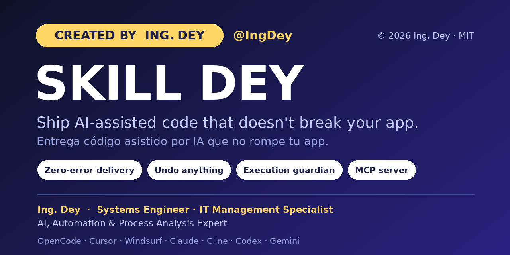
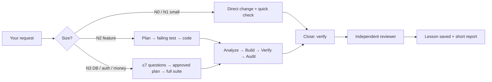

<div align="center">



# 🚀 SKILL DEY

### Ship AI-assisted code that doesn't break your app.

An agentic quality framework for AI-assisted development: it understands what you ask, builds **without breaking** what already works, and refuses to hand back anything with **errors**. Tests, security, documentation and token savings come built in.

[](LICENSE.md)
[](#-quick-install)
[](https://opencode.ai)
[](#claude-code)
[](#gemini-cli-and-antigravity-cli)
[](https://modelcontextprotocol.io/)
[](#-works-with-your-ai)
[](https://github.com/IngDey)
[](https://github.com/IngDey/SKILL-DEY-Enterprise-Agentic-Framework-AI-Development-Suite/stargazers)

**English** · [Español](README.es.md)

**Created and built by [Ing. Dey (@IngDey)](https://github.com/IngDey)**<br>
<sub>Systems Engineer · IT Management Specialist · Expert in AI, Automation & Process Analysis</sub>

⭐ **Star the repo** if it helps you ship better code · [⚡ Install in 1 minute](#-quick-install)

</div>

---

## Why SKILL DEY?

AI assistants write code fast, and they also break working features, leak secrets, skip tests and say "done" when it isn't. SKILL DEY puts a **quality loop and a guardian** around your AI so "it works" means *verified*, not *claimed*.

| | What you get |
|---|---|
| ✅ **Zero-error delivery** | A task only closes after verification: whole-project review, security audit, automatic tester, formatting, N+1 performance check and server-side validation. |
| 🛟 **Undo anything** | An automatic snapshot before every request. Say *"deshaz"* (undo) and your files are back, even for small changes. It never touches your branches or history. |
| 🛡️ **Execution guardian** | Blocks secrets in code, reading `.env`, `git push --force`, commits that weren't verified, `.env` going to git, DB migrations without a backup, truncated code (`// ...rest of the code`) and writes outside your project. |
| 🎯 **Changes only what you ask** | If the AI wants to touch a file you didn't ask for, it stops and asks you. No rewriting whole files, no "improvements" nobody requested. |
| 🧩 **Thinks before touching** | Before the first change it writes what it understood, the cause and the plan. Every edit is measured: it tells you which other files use what changed. |
| 🚑 **Never leaves the app broken** | If the app was healthy and the change breaks it and can't be fixed in 3 tries, it goes back to the healthy state on its own (you can "rehaz"). |
| 🌍 **Chrome testing** | Walks your app in your own Chrome and reads the console, JS errors, network and HTTP responses, with screenshots. |
| 🧠 **Persistent project memory** | Decisions, lessons and business rules live in `.skill_dey/` (`BITACORA`, `DECISIONES`, `LECCIONES`, `NEGOCIO`, `ESTADO`, `MARCA`) so context survives across sessions. |
| 🤖 **Multi-agent** | A main agent, a read-only **explorer** for big searches, a **vision** agent that turns mockups/screenshots into UI, and an **independent reviewer** that audits changes it didn't write. |
| 📉 **Token-aware** | Small tasks don't load the skill; heavy workflows load only when needed. A usage board shows tokens, cost and time per answer. |
| 🔌 **MCP server included** | Exposes the checks and undo as native tools to any MCP client (protocol up to 2025-11-25). |
| 🌐 **Native in 4 AIs** | **OpenCode, Claude Code, Gemini CLI and Antigravity CLI** with the same live guardian, the same skill and the same rules. |
| 🏢 **Safe AI use at work** | `politicas-ia` skill: drafts and reviews your company's AI usage policy for people (what to use, what not, which data never to share). |

### 🆕 What's new in version 41

Built on v38.14.1 (everything in OpenCode stays the same) and adds:

- **Native in Claude Code, Gemini CLI and Antigravity CLI** with the **same guardian** as OpenCode: only what you asked, reason before touching, impact of every edit, undo, never leave the app broken, and continuity across sessions.
- **One rule source** (`app/skill_dey-lib/guardia.ts`) for all four AIs; a fix reaches all of them at once.
- **More protection:** blocks running downloaded scripts unread (`curl … | sh`) and recognizes today's AI and cloud keys (Anthropic, OpenAI, Google, GitHub, Slack, temporary AWS).
- **Fixed:** answering *"sí"* with an accent wasn't taken as approval.
- **Modern MCP server:** protocol up to 2025-11-25, verify, undo (with redo and history), freeze, and fewer tokens per message.
- **New `politicas-ia` skill:** a safe-AI-use policy for the people in your company.
- **36 automated tests** on Windows, macOS and Linux on every change.

---

## 🎯 Who is it for?

- **Developers** who use AI daily and are tired of fixing what it broke.
- **Tech leads and IT managers** who need AI-generated code to meet a standard: tests, security, documentation, traceability.
- **Companies** that want to adopt AI in development with control, not by trial and error.
- **Beginners** who build with AI and need a safety net that catches what they don't know yet.

## ⚖️ Your AI alone vs. your AI with SKILL DEY

| Your AI alone | With SKILL DEY |
|---|---|
| Says "done" without running anything | Closes the task only when the checks are green |
| Fixes one thing, breaks another | Reviews the whole project and the impact of each change |
| Can paste API keys into the code or read your `.env` | The guardian blocks it before it happens |
| A bad change means rebuilding by hand | Write *"deshaz"* and your files are back |
| Forgets everything between sessions | Decisions, rules and lessons persist in `.skill_dey/` |
| Documentation "later" (never) | Technical manual, data dictionary, user manual and PDFs on request |

---

## 🧭 How it works



- **Verification is code, not opinion.** "Works" means the verifier is green, not that the model said so.
- **Repeated failures escalate.** Three red checks in a row trigger a *systematic diagnosis* cycle; the next one triggers a brake (undo and report).
- **Existing app?** *Adoption mode* backs it up, reviews all code, boots back + front, audits security and business logic, and writes a prioritized report to `.skill_dey/ADOPCION.md`. It fixes only what is broken or high-risk and **asks before touching business logic**.

---

## ⚡ Quick install

**Requirements:** [Node.js](https://nodejs.org/) 20+ and [Git](https://git-scm.com/) (recommended: it powers full undo). Plus at least one of: [OpenCode](https://opencode.ai), [Claude Code](https://www.claude.com/product/claude-code), [Gemini CLI](https://geminicli.com) or [Antigravity CLI](https://antigravity.google).

### Option 1 · One click (installs into EVERY AI you have)

```bash
git clone https://github.com/IngDey/SKILL-DEY-Enterprise-Agentic-Framework-AI-Development-Suite.git
cd SKILL-DEY-Enterprise-Agentic-Framework-AI-Development-Suite
```

No Git? Download the `.zip` from [Releases](../../releases) and unzip it.

| System | What to do |
|---|---|
| **Windows** | Double-click `INSTALAR.bat` |
| **macOS** | Double-click `INSTALAR.command` (if macOS blocks it: `bash INSTALAR.command` in Terminal) |
| **Linux** | `bash INSTALAR.command` |

The installer detects OpenCode, Claude Code, Gemini CLI and Antigravity CLI and sets SKILL DEY up in each. Then **restart your AI** and write normally. Reinstalling is safe: it updates everything and **keeps what was learned**.

### Option 2 · From your AI

<a id="claude-code"></a>**Claude Code** (inside Claude):

```
/plugin marketplace add IngDey/SKILL-DEY-Enterprise-Agentic-Framework-AI-Development-Suite
/plugin install skill-dey@skill-dey
```

<a id="gemini-cli-and-antigravity-cli"></a>**Gemini CLI** and **Antigravity CLI** (in a terminal, from the downloaded folder):

```bash
gemini extensions install ./hosts/gemini-cli     # Gemini CLI
agy plugin install ./hosts/antigravity            # Antigravity CLI (Gemini CLI's successor)
```

**OpenCode:** use option 1.

<details>
<summary><b>🔍 What exactly does the installer change? (click to expand)</b></summary>

Nothing hidden. The installer:

1. **OpenCode:** copies the skill, agents, commands, tools and guardian plugin into `~/.config/opencode/` (or `$OPENCODE_CONFIG_DIR`); sets `default_agent` to `skill_dey` (saving `opencode.json.bak` first) and adds its rules to `AGENTS.md` inside clearly marked `SKILL_DEY` blocks.
2. **Claude Code, Gemini CLI and Antigravity CLI** (only if installed): copies their package to `~/.config/skill_dey/paquetes/` and installs it with each AI's official command (`claude plugin install`, `gemini extensions install`, `agy plugin install`). If your AI asks for confirmation (for example "do you trust this folder?"), **you answer**.
3. Registers the MCP server in **Cursor, Windsurf, Claude Desktop and Cline** *only if they are installed*. Each config is backed up as `*.antes-skill_dey.bak` and only the `skill_dey` entry is added or updated.
4. Warns you if `git`, `opencode` or `python` is missing, with the install command for your OS.

On Windows, the no-Node installer runs PowerShell with `-ExecutionPolicy Bypass` for that script only (and installs the OpenCode edition only). You can read it first in [`app/instalador/`](app/instalador/).
</details>

### Verify it works

- **OpenCode:** ask **"¿skill_dey está funcionando?"**. It self-checks every time you open it and only warns you if something fails.
- **Claude Code:** `/plugin` should list `skill-dey` as enabled and `/mcp` should show the `skill_dey` server.
- **Gemini CLI:** `gemini extensions list` should show `skill-dey` with its context, skills and MCP.
- **Antigravity CLI:** `agy plugin list` should show `skill-dey`.
- In any of them, ask: *"try to drop the customers table"*. The guardian must block it.

---

## 💬 Using it

You don't need commands. Write normally: *"add the field `owner` to tickets"*, *"check the site has no errors"*, *"document the app"*.

| Say | What happens (mostly by code, almost no tokens) |
|---|---|
| `iniciar skill dey` / `finalizar skill dey` | Turn SKILL DEY on / off (state is remembered) |
| `revisa que no haya errores` | Crawls **every page**, detects 404/500, console errors, failing assets, broken links, visible PHP/SQL errors, `undefined`/`NaN`; fixes root causes and repeats until clean |
| `revisa la seguridad` / `prueba la app` | Security audit + automatic tester (valid data, required fields, SQL/XSS attacks, access without session), including forms rendered by JavaScript (React/SPA) |
| `documenta la app` | Regenerates `docs/MANUAL-TECNICO.md`, `DICCIONARIO-DATOS.md`, `MANUAL-USUARIO.md`, `database/instalacion.sql` and PDFs |
| `deshaz` | Restores the snapshot taken before your last request (redo available) |
| `/skill_dey ayuda` | Lists every command in 6 groups (OpenCode) |
| `/skill-dey:verificar`, `/skill-dey:auditar`, `/skill-dey:deshacer` | Shortcuts in Gemini CLI |

---

## 🌐 Works with your AI

| Tool | What it gets |
|---|---|
| **OpenCode** | Full experience: live guardian, undo, automatic model switch when the quota runs out, usage board, 20+ dedicated tools |
| **Claude Code** | Official plugin: `skill-dey` and `politicas-ia` skills, subagents (reviewer, explorer, vision), **live guardian via hooks**, zero-token `deshaz`, MCP server |
| **Gemini CLI** | Extension: `GEMINI.md`, skills, subagents, **live guardian via hooks**, `/skill-dey:*` commands, MCP server |
| **Antigravity CLI** | Plugin: rules, skills, subagents, **live guardian via hooks**, MCP server |
| **Cursor · Windsurf · Claude Desktop · Cline** | MCP server registered by the installer + project rules |
| **Codex · Copilot · Zed · Firebase Studio** | Project rules (`multi-ia` command) + CLI checks |

### What the live guardian does (all 4 AIs)

| Protection | OpenCode | Claude Code | Gemini CLI | Antigravity |
|---|:-:|:-:|:-:|:-:|
| Snapshot before each request · `deshaz`, `deshaz solo <file>`, `vuelve a antes de <request>` | ✅ | ✅ | ✅ | ✅ (via the tool) |
| Never drops or empties DBs/tables (SQL, ORM, `.sqlite` file, Docker volumes) · backup before migrating | ✅ | ✅ | ✅ | ✅ |
| Blocks secrets in code, reading or writing real `.env`, `push --force`, mass deletes, `curl … \| sh` | ✅ | ✅ | ✅ | ✅ |
| Changes only what you ask · no whole-file rewrites | ✅ | ✅ | ✅ | ✅ |
| Reason before touching (`Entendí · Causa · Plan`) | ✅ | ✅ | — | — |
| Impact: tells you which other files use what changed | ✅ | ✅ | ✅ | ✅ (at close) |
| Instant syntax check · won't finish with errors · rolls back to the healthy state | ✅ | ✅ | ✅ | ✅ |
| Truncated code, outside the project, frozen zones, unrequested dependencies, anti-loop | ✅ | ✅ | ✅ | ✅ |
| "Where were we?" and new sessions get the latest requests | ✅ | ✅ | ✅ | — |
| Model by task · automatic model switch · usage board | ✅ | — | — | — |

All four use **the same rules** (`app/skill_dey-lib/guardia.ts`). If a guardian piece hits something unexpected, it **lets you keep working** and logs it to `~/.config/skill_dey/errores-hook.log`: it never freezes your AI.

### MCP server

Tools: `skill_dey_verificar`, `skill_dey_deshacer` (also redo and history), `skill_dey_chrome`, `skill_dey_seguridad`, `skill_dey_validar`, `skill_dey_documentar`, `skill_dey_organizar`, `skill_dey_produccion`, `skill_dey_movil`, `skill_dey_pruebas`, `skill_dey_capacitar`, `skill_dey_congelar`. Each one is marked read-only or destructive so your AI asks permission when it should. The project folder is required: it never uses your home folder or the disk root.

Manual setup (any MCP client):

```json
{
  "mcpServers": {
    "skill_dey": {
      "command": "node",
      "args": ["/Users/YOUR_USER/.config/opencode/skill_dey/skill_dey-mcp.mjs"]
    }
  }
}
```

```bash
# Rules each AI reads by itself (AGENTS.md, CLAUDE.md, GEMINI.md, .cursorrules, copilot-instructions.md, ...)
node ~/.config/opencode/skill_dey/skill_dey.mjs multi-ia .
# Universal CLI (any AI with a terminal)
node ~/.config/opencode/skill_dey/skill_dey.mjs revisar|seguridad|pruebas|capacitar|movil|organizar|documentar|validar|produccion [folder] [url]
```

> **Honest note:** the automatic model switch and the usage board rely on features only OpenCode exposes to plugins. Gemini CLI stopped serving personal accounts on June 18, 2026 and its successor is **Antigravity CLI**: SKILL DEY ships a package for both.

---

## 🧪 Tested, with receipts

- **In-depth review of v38.14.1** and its tests (Chrome with seeded errors, a 30,000-file project, security, installation): [`docs/PRUEBAS-REALIZADAS.md`](docs/PRUEBAS-REALIZADAS.md). History of versions 13 to 32: [`docs/PRUEBAS-HISTORICO.md`](docs/PRUEBAS-HISTORICO.md).
- **36 automated tests** for the Claude Code, Gemini CLI and Antigravity guardian and the MCP server: `npm test`. They run on Windows, macOS and Linux on every change (GitHub Actions).
- **The OpenCode guardian decides exactly as in v38.14.1:** the same 19 situations tested side by side; only the two new blocks differ.
- The plugin passes `claude plugin validate` and installs on Claude Code 2.1; the extension passes `gemini extensions validate` and installs on Gemini CLI 0.67.
- A [10-case benchmark](app/skills/skill-dey/evals/BANCO-DE-PRUEBAS.md) and a comparer (`evals/comparar.mjs`) to measure SKILL DEY against the raw AI **with your own model**.

Known limits, stated plainly: the Antigravity package follows the official plugin specification but hasn't been run with `agy` on a real machine yet (run `agy plugin validate --strict ./hosts/antigravity` and let us know). Decision quality depends on the model you use.

---

## 📁 Repository layout

```
INSTALAR.bat / INSTALAR.command   one-click installers (every AI)
app/                              the single source
  skill_dey-lib/                  engine: guardia.ts (guardian rules), hook.ts, mcp.ts, undo, security, tester, docs
  skills/skill-dey/               OpenCode skill: levels, cycle, references, memory templates
  portable/                       rules, skills (skill-dey, politicas-ia) and agents for Claude/Gemini/Antigravity
  agents/ · commands/ · tools/    OpenCode edition
  plugins/skill_dey-guardian.ts   OpenCode guardian
  cli/ · mcp/ · hook/             bundled engine (no dependencies)
  instalador/                     installers (Node, PowerShell, bash) and MCP registrar
hosts/                            generated packages: claude-code · gemini-cli · antigravity
.claude-plugin/marketplace.json   Claude Code marketplace
scripts/build.mjs                 builds hosts/ and the engine from app/
tests/                            automated guardian and MCP tests
docs/                             install guide and test log
```

---

## ❓ FAQ

<details><summary><b>Is it free?</b></summary>

Yes. MIT license: use it in personal and commercial projects. Just keep the credit.
</details>
<details><summary><b>Do I need to know how to program?</b></summary>

No. You write in plain language (Spanish or English) and SKILL DEY decides how deep to go. Experienced developers get the same checks plus the CLI and MCP tools.
</details>
<details><summary><b>Does it send my code anywhere?</b></summary>

No. The checks run on your machine and SKILL DEY has no telemetry. Its only network requests go to the site URLs you ask it to check (for example, your local app). Your code reaches a model only through the AI tool you already use.
</details>
<details><summary><b>Will it mess up my current setup?</b></summary>

The installer backs up every config it touches (`.bak` files), only edits its own clearly marked blocks, and reinstalling is safe. See *What exactly does the installer change?* above.
</details>
<details><summary><b>Which AI should I use?</b></summary>

The one you already use. OpenCode adds the automatic model switch and the usage board; Claude Code, Gemini CLI and Antigravity CLI get the same guardian, the same skill and the same undo. You can have it in several at once.
</details>
<details><summary><b>Can I turn it off for a while?</b></summary>

Yes. Write `finalizar skill dey`, and `iniciar skill dey` to turn it back on. It works the same in all four AIs.
</details>
<details><summary><b>I already have an app. Can I use it there?</b></summary>

Yes. *Adoption mode* backs it up, audits it and writes a prioritized report before changing anything, and it asks before touching business logic.
</details>

## 👤 Author

<table>
<tr>
<td width="110" align="center"><a href="https://github.com/IngDey"></a></td>
<td>

**Ing. Dey** · [@IngDey](https://github.com/IngDey)<br>
🎓 **Systems Engineer** · **Specialist in IT Management**<br>
🤖 Expert in **Artificial Intelligence**, **automation** and **business process analysis**

</td>
</tr>
</table>

SKILL DEY was designed, built and is maintained by Ing. Dey. It brings together two worlds: the engineering discipline of building software that works, and the management view of IT, where every change must be controlled, verified, documented and aligned with the business. The framework applies that same method to AI: analyze the process, automate what can be automated, and verify everything before calling it done.

If it helps you, follow [@IngDey](https://github.com/IngDey) for updates, ⭐ the repo and share it with your team.

**Built something with SKILL DEY?** Add this badge to your README:

[](https://github.com/IngDey/SKILL-DEY-Enterprise-Agentic-Framework-AI-Development-Suite)

```markdown
[](https://github.com/IngDey/SKILL-DEY-Enterprise-Agentic-Framework-AI-Development-Suite)
```

## 🤝 Contributing

Ideas, bug reports and PRs are welcome. See [CONTRIBUTING.md](CONTRIBUTING.md). If SKILL DEY saved your project, a ⭐ helps other developers find it.

## 📄 License

[MIT](LICENSE.md) © 2026 Ing. Dey (@IngDey). Free to use, modify and distribute; please keep the credit.
